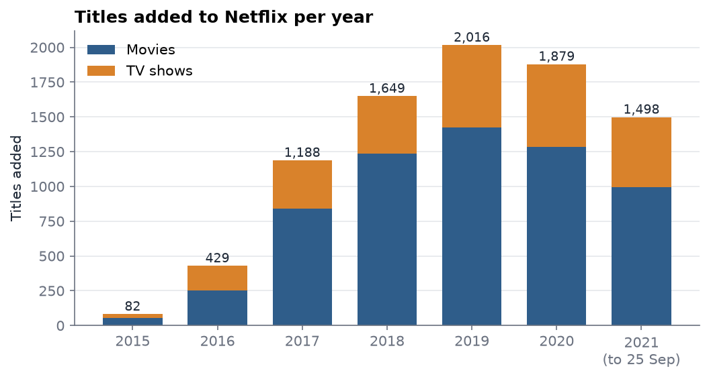
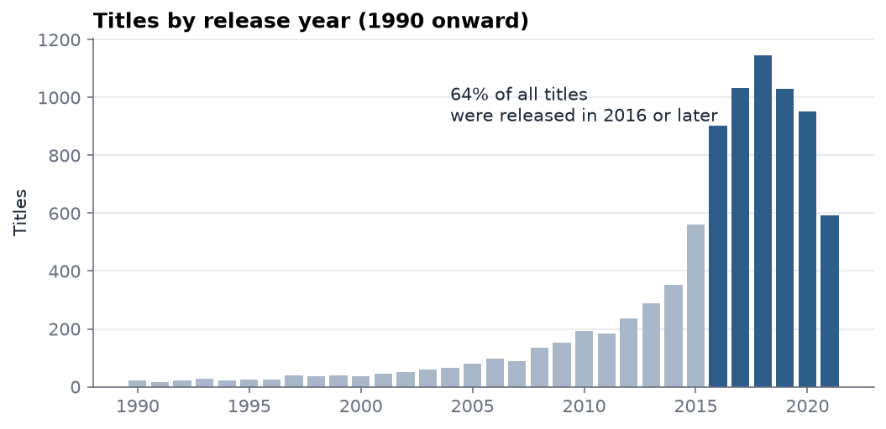
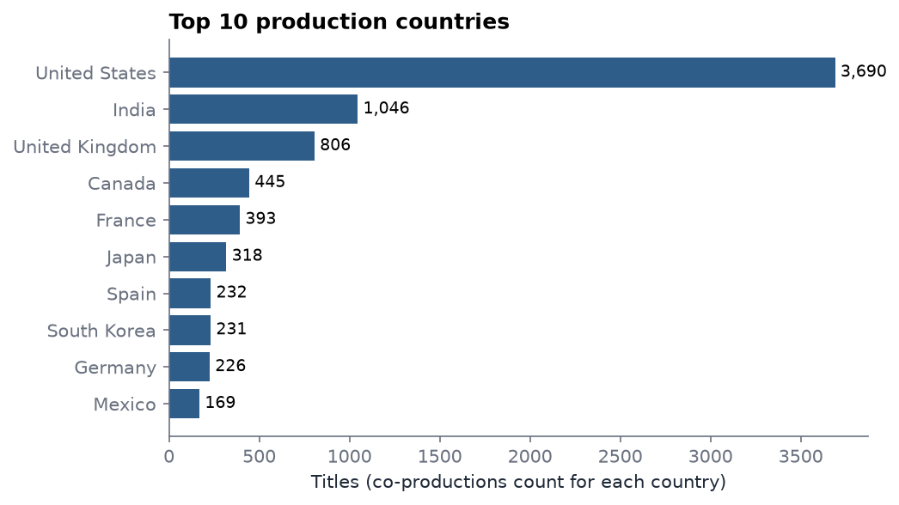
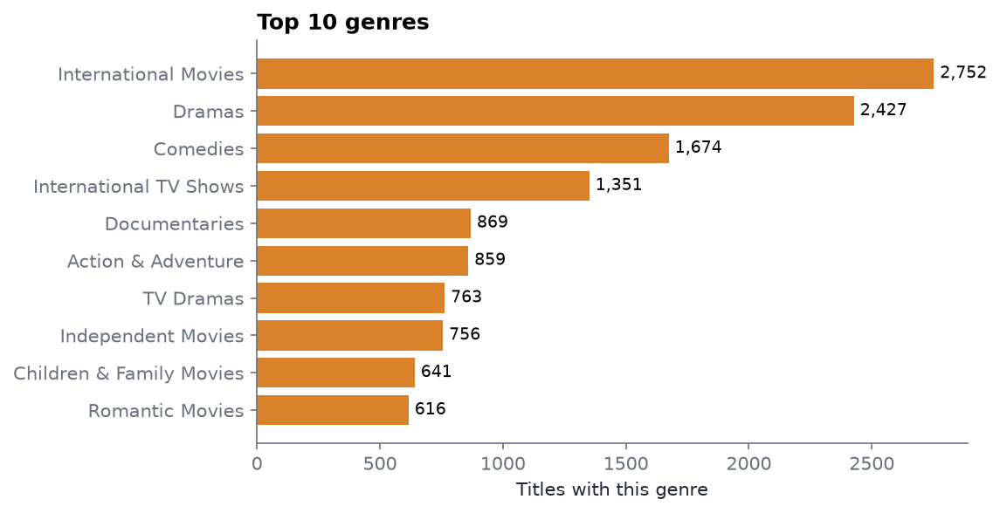
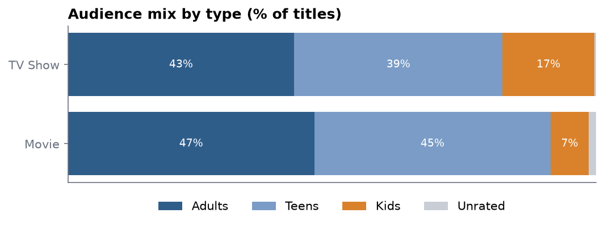
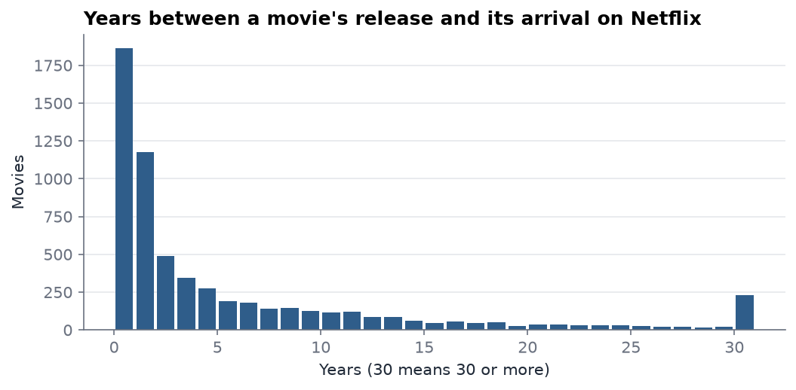

# Netflix Catalog Analysis

An analysis of 8,807 Netflix movies and TV shows: what the catalog contains, where it comes from, who it is for, and how it grew between 2015 and 2021. I cleaned the data in Python, analysed it in a Jupyter notebook, and built an interactive Power BI dashboard on the same cleaned tables.

## The questions

- How fast did the catalog grow, and did the mix of movies and TV change?
- How recent is the content?
- Which countries and genres dominate?
- Who is the catalog aimed at, and how long do movies take to reach Netflix?

## Data

The public "Netflix Movies and TV Shows" dataset from Kaggle by Shivam Bansal ([link](https://www.kaggle.com/datasets/shivamb/netflix-shows)), scraped up to 25 September 2021: 8,807 titles and 12 columns. The raw file is in `data/raw/` so the project runs without a Kaggle account; see the Kaggle page for its licence terms.

## What I did

1. **Cleaning** (`src/clean.py`)
   - Three stand-up specials had their running time in the rating column and no duration, so I moved it to where it belongs.
   - I stripped whitespace (88 dates had a leading space and wouldn't parse) and stray commas in 7 country lists.
   - Missing director, cast and country become "Unknown" so the titles still count. The 10 missing dates stay blank rather than being guessed.
   - I split duration into minutes for movies and seasons for TV shows, and grouped the 14 ratings into four audiences (Adults, Teens, Kids, Unrated).
   - I computed how many years each movie took to reach Netflix. This is movies only, because a TV show's release year is its latest season.
2. **Modelling.** Genres and countries are comma-separated lists, so I split them into two bridge tables with one row per title and value. Without that, "United States, India" counts as a country of its own, and Power BI can't filter titles by genre.
3. **Analysis** (`notebooks/netflix_analysis.ipynb`): the charts below, with the reasoning for each.
4. **Dashboard** (`powerbi/`): KPI cards, slicers for type, genre, country, audience and year, and a drill-through page from any bar to the titles behind it. `POWERBI_GUIDE.md` has the model, the DAX measures and the numbers the dashboard has to match.

## Findings

**The catalog grew almost fivefold in three years.** Additions went from 429 titles in 2016 to a peak of 2,016 in 2019. 2021 stops in September, so its lower bar is a partial year.



**Most of the content is recent.** 64% of titles were released in 2016 or later. (98% were *added* in 2016 or later, but that mainly reflects when the data was scraped, so release year is the more useful measure.)



**The US dominates, and India is a clear second.** The US is involved in 3,690 titles, 46% of those with a known country. India has 1,046, ahead of the UK with 806. Co-productions count once per country.



**International Movies, Dramas and Comedies are the biggest genres.** A title can have up to three genre labels, so this counts labels.



**Adult content leads for both formats, but TV carries far more kids' content:** 17% of TV shows against 7% of movies.



**Half of movies reach Netflix within two years of release.** 30% arrive the same year, while about one in five is 10 or more years old when added.



A typical movie runs 98 minutes, and two thirds of TV shows have a single season.

## Dashboard

<!-- Replace this line with:  -->
*Screenshot of the Power BI dashboard to be added.*

## How to run

```
python -m venv .venv
.venv\Scripts\activate          # Windows; on macOS/Linux: source .venv/bin/activate
pip install -r requirements.txt

python src/clean.py             # writes the three tables to data/clean/
jupyter notebook notebooks/netflix_analysis.ipynb
```

For the dashboard, open `powerbi/netflix_dashboard.pbix` in Power BI Desktop, or build it from scratch with `powerbi/POWERBI_GUIDE.md`.

## Limitations

- It is a snapshot of the catalog as scraped in September 2021. Titles that left Netflix before then are not in it, so "added per year" counts surviving titles, not everything Netflix ever added.
- There is no viewing data, so nothing here says what people actually watch.
- There is no flag for Netflix originals. The same-year arrivals probably include many of them, but the data can't separate them from licensed titles.
- Next I would join IMDb ratings by title and year to compare quality across countries and genres, and add a newer scrape to see how the catalog changed after 2021.
